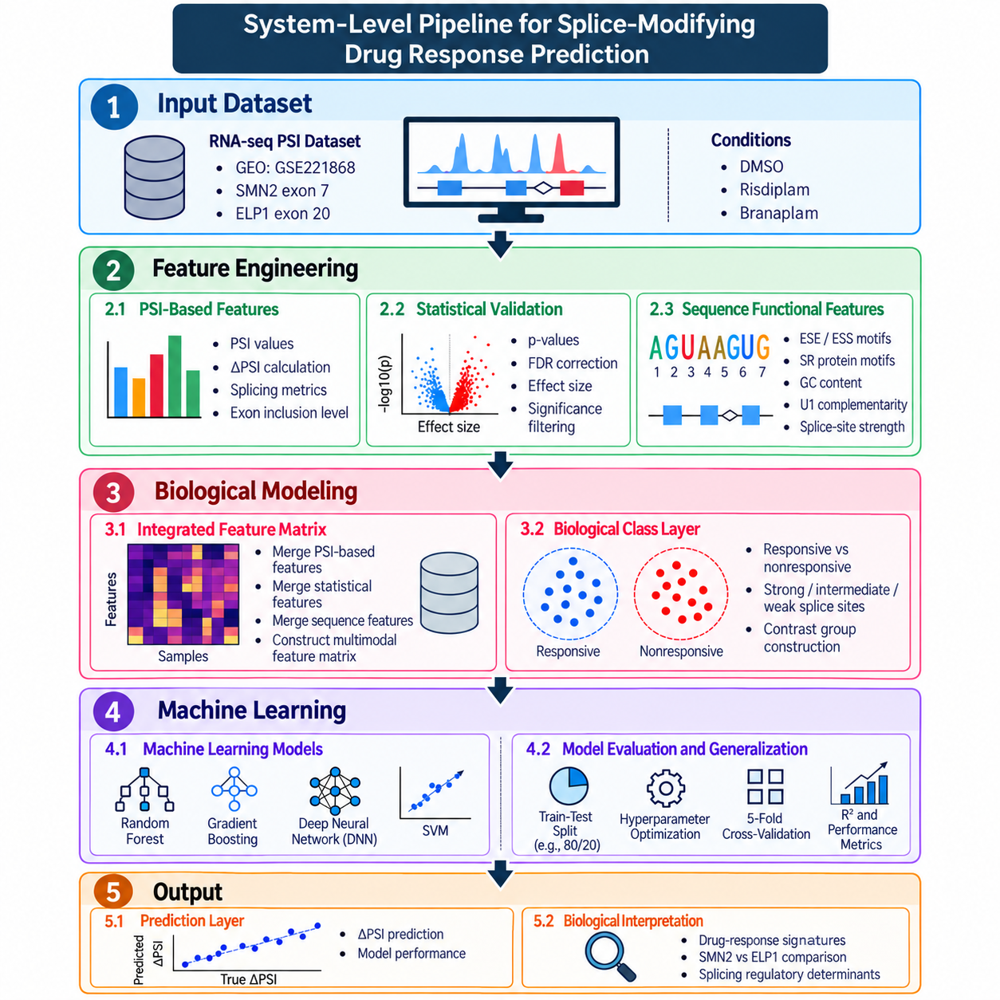
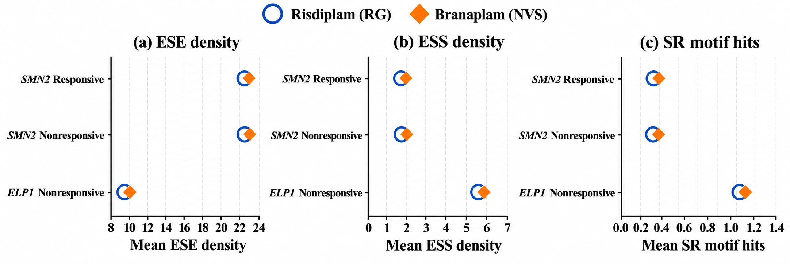

# SMA-splicing-drug-response-ML
Machine learning framework integrating RNA splicing, sequence regulatory features, and statistical analysis to model splice-modifying drug responses in spinal muscular atrophy.

# Machine Learning-Based Modeling of Splice-Modifying Drug Responses in Spinal Muscular Atrophy

**IEEE HONET-ICT 2025 | Accepted Research Paper**

**Research Areas:** Machine Learning · Computational Genomics · RNA Splicing · Systems Biology · Biomedical Data Analysis

## Overview

This repository accompanies the research paper:

**A Systems-Level In Silico Framework for Machine Learning-Based Modeling of Splice-Modifying Drug Responses in Spinal Muscular Atrophy**

The study introduces an exploratory computational framework for investigating how RNA splice-site characteristics influence responses to two splice-modifying compounds, **risdiplam** and **branaplam**, in spinal muscular atrophy (SMA).

The framework integrates sequence-derived regulatory features, Percent Spliced In (PSI) measurements, statistical descriptors, and machine learning models to characterize on-target and off-target splicing responses.

## Research Objectives

1. Construct a multimodal feature representation of RNA splice sites.
2. Characterize drug-induced splicing changes using PSI-derived measurements.
3. Identify sequence-regulatory characteristics associated with splice-site responsiveness.
4. Compare machine learning approaches for predicting drug-induced changes in exon inclusion.
5. Investigate differences between on-target SMN2 and off-target ELP1 splice-site behavior.

## Dataset

**Source:** NCBI Gene Expression Omnibus (GEO)

**Accession:** [GSE221868](https://www.ncbi.nlm.nih.gov/geo/query/acc.cgi?acc=GSE221868)

The study considers:

| Gene | Splice-site variants | Role |
|---|---:|---|
| SMN2 | 285 | Primary therapeutic target |
| ELP1 | 32,245 | Off-target comparison |

Experimental conditions include:

- Risdiplam
- Branaplam
- DMSO control

Only the 285 SMN2 variants were used for regression modeling. ELP1 variants were analyzed separately for descriptive and sequence-based comparisons.

## Computational Methodology

The proposed framework consists of five main stages.

### 1. Data Acquisition and Preprocessing

- Retrieval of RNA splicing measurements
- Extraction of splice-site sequences and genomic context
- Organization of drug-specific PSI measurements
- Handling of missing values
- Construction of condition-specific feature matrices

### 2. Multimodal Feature Engineering

The integrated representation combines:

- PSI-based splicing descriptors
- Exonic splicing enhancer (ESE) features
- Exonic splicing silencer (ESS) features
- SR protein-binding motif descriptors
- Splice-site sequence composition
- Statistical variability measurements

### 3. Statistical Analysis and Biological Classification

- Drug-induced splicing response analysis
- Wilcoxon signed-rank testing
- Benjamini-Hochberg false discovery rate correction
- Threshold-based response classification
- Construction of drug-specific contrast groups

### 4. Machine Learning

Four regression models were investigated:

- Random Forest (RF)
- Gradient Boosting
- Support Vector Regression (SVR)
- Deep Neural Network (DNN)

The regression task predicts drug-induced changes in exon inclusion (ΔPSI).

Model evaluation included cross-validation, R², RMSE, and an additional nested cross-validation analysis.

### 5. Model Interpretation

- Comparison of drug-specific predictive performance
- Sequence-regulatory feature analysis
- Random Forest permutation importance
- Assessment of model limitations and generalizability

- 
## Research Framework and Visualizations

### Computational Pipeline

**Figure 1.** System-level computational pipeline integrating RNA splicing measurements, statistical analysis, sequence-regulatory features, and machine learning for splice-modifying drug-response modeling.

### Sequence-Regulatory Feature Analysis

**Figure 2.** Comparison of mean exonic splicing enhancer (ESE) density, exonic splicing silencer (ESS) density, and SR protein motif hits across SMN2 and ELP1 splice-site response categories.

### Machine Learning Feature Importance

**Figure 3.** Random Forest permutation feature importance for risdiplam and branaplam, measured by the mean increase in held-out mean squared error (MSE). Baseline DMSO PSI was the dominant predictor.

### Splice-Site Response Distributions

**Figure 4.** Two-dimensional dot-cloud visualizations of responsive and nonresponsive splice-site categories for SMN2 and ELP1 under risdiplam and branaplam conditions.
  

## Experimental Results

### Original Model Evaluation

| Model | Risdiplam R² | Branaplam R² |
|---|---:|---:|
| Random Forest | 0.273 | 0.262 |
| Gradient Boosting | 0.249 | 0.250 |
| Support Vector Regression | -0.030 | -0.050 |
| Deep Neural Network | 0.252 | 0.192 |

Random Forest achieved the highest R² in the original model evaluation for both drug conditions.

### Additional Nested Cross-Validation

| Model | Risdiplam R² | Branaplam R² |
|---|---:|---:|
| Training-mean baseline | -0.003 | -0.010 |
| Random Forest | 0.274 | 0.201 |
| Support Vector Regression | 0.302 | 0.197 |

These results were obtained using a separate evaluation protocol and should not be directly compared with the original evaluation as though the experimental configurations were identical.

### Biological Findings

- The classification framework identified 15 risdiplam-responsive and 81 branaplam-responsive SMN2 splice sites.
- Sequence-regulatory analysis revealed descriptive differences between SMN2 and ELP1 splice-site groups.
- Baseline DMSO PSI was the dominant predictor in the Random Forest permutation importance analysis.
- Individual regulatory descriptors did not significantly distinguish responsive from nonresponsive SMN2 groups after multiple-testing correction.

## Research Limitations

This study presents an exploratory computational framework rather than a clinically validated drug-response prediction system.

Predictive performance remained modest. Independent experimental validation and sequence-aware generalization assessment were not performed.

Future work should investigate independent datasets, sequence-aware validation strategies, and improved representations of splice-site regulatory interactions.

## Publication

**Mahtabi Nourani, K., Demirel, H., Seytanoglu, A., and Yağlı, C.**

*A Systems-Level In Silico Framework for Machine Learning-Based Modeling of Splice-Modifying Drug Responses in Spinal Muscular Atrophy.*

IEEE HONET-ICT 2025 — Accepted.

## Author and Contact

**Kiana Mahtabi Nourani**

MSc Candidate, Electrical and Electronic Engineering  
Eastern Mediterranean University

Research Interests: Artificial Intelligence, Machine Learning, Computational Genomics, Systems Biology, and Biomedical Engineering.

[Google Scholar](https://scholar.google.com/citations?user=Sr7txOEAAAAJ) | [GitHub](https://github.com/kianamahtabinourani)

## Repository Status

Repository documentation is being prepared. Research scripts, selected figures, and reproducibility materials will be added following code review and organization.
